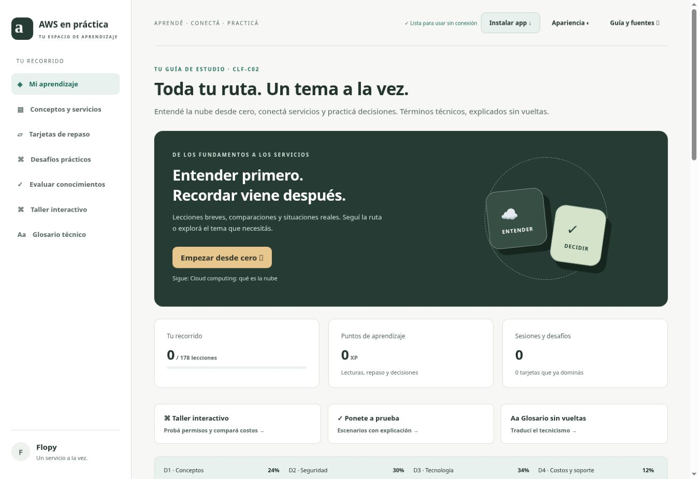
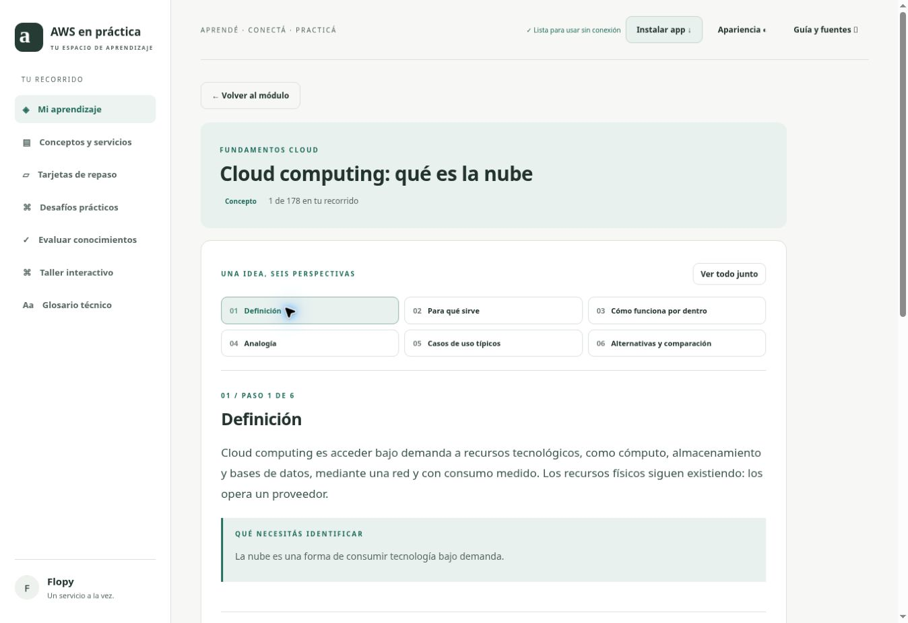
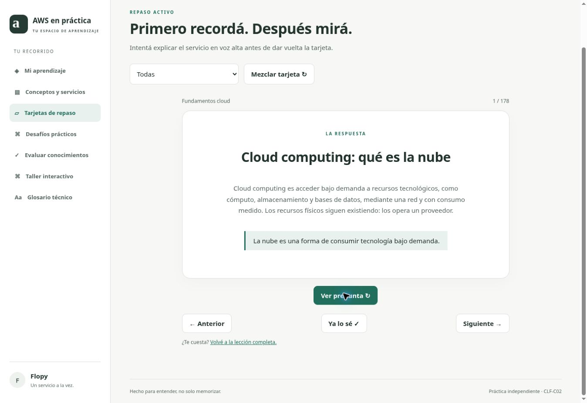
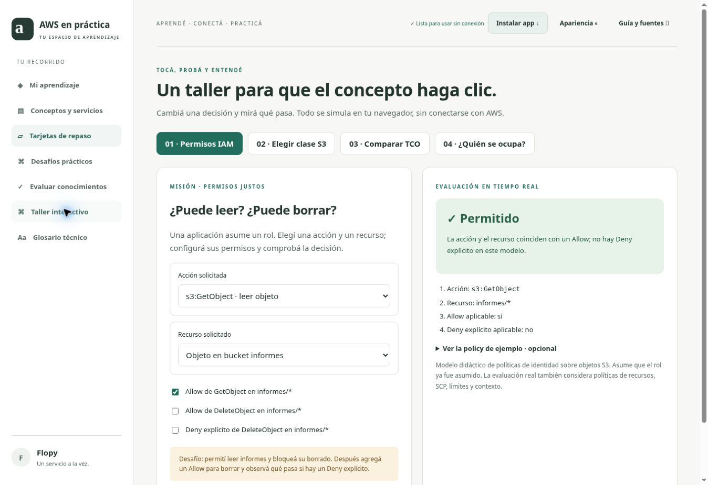
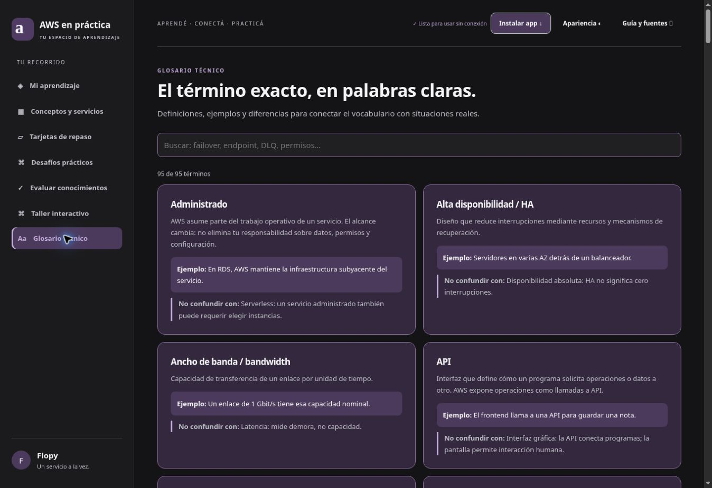
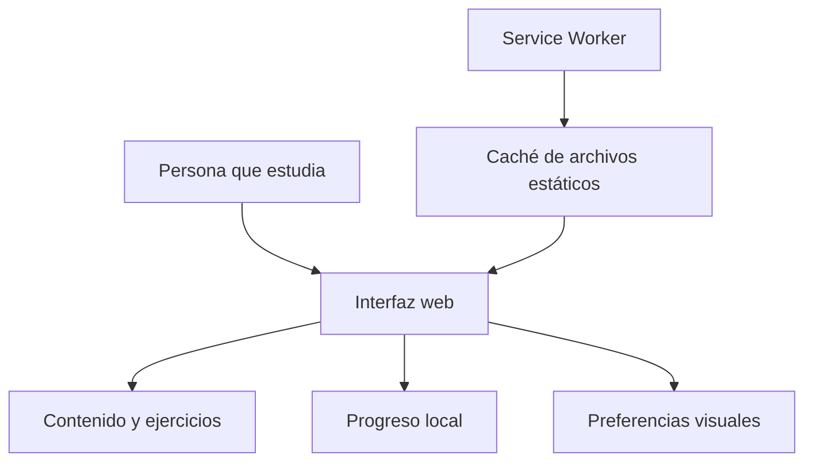

<div align="center">

# AWS en práctica

### Entender la nube. Conectar servicios. Practicar decisiones.

**PWA educativa en español · AWS Cloud Practitioner · Aprendizaje activo**

[El problema](#el-problema) · [Funcionalidades](#funcionalidades) · [Capturas](#capturas) · [Ejecución](#ejecución-local) · [Documentación](#documentación)

</div>



## El problema

Estudiar AWS implica recorrer documentación, videos, apuntes y bancos de preguntas con distintos niveles de profundidad. Esa dispersión dificulta seguir una ruta, comparar servicios parecidos y transformar una definición en una decisión práctica.

**AWS en práctica reúne una ruta de estudio, explicaciones consistentes y actividades interactivas en una aplicación que puede instalarse y usarse sin conexión después de su primera carga completa.** Su objetivo es reducir la fragmentación del estudio y ayudar a entender cuándo conviene elegir cada servicio.

El resultado es una herramienta funcional de aprendizaje. No se han medido todavía mejoras de rendimiento académico ni tasas de aprobación.

## Funcionalidades

| Experiencia | Implementación |
| --- | --- |
| Ruta de aprendizaje | 178 lecciones organizadas en 19 módulos |
| Explicación consistente | Definición, utilidad, funcionamiento, analogía, casos típicos y comparación |
| Lectura flexible | Paso a paso o los seis apartados juntos |
| Repaso activo | Tarjetas con giro 3D y marcado de conceptos dominados |
| Práctica guiada | 9 desafíos con 27 decisiones y explicaciones |
| Evaluación | Cuestionarios por tema y mini desafíos de escenario |
| Talleres | Permisos IAM, clases S3, TCO y responsabilidad compartida |
| Glosario | 95 términos en orden alfabético, todos con definición, ejemplo y comparación |
| Seguimiento | Lecciones estudiadas, apuntes, historial y puntos de aprendizaje |
| Personalización | Cinco paletas mate, modos claro y oscuro y movimiento reducido |
| Portabilidad | Exportación e importación del progreso en JSON |
| PWA | Instalación, caché sin conexión y aviso de actualización |

## Cómo se usa

1. Elegir un módulo o continuar la siguiente lección pendiente.
2. Recorrer las seis perspectivas del concepto y escribir apuntes propios.
3. Resolver el mini desafío y revisar su explicación.
4. Repasar con tarjetas y aplicar decisiones en los talleres.
5. Exportar el progreso para conservar una copia o trasladarlo a otro navegador.

## Capturas

Capturas reales de la versión incluida en este repositorio.

| Lección guiada | Repaso activo |
| --- | --- |
|  |  |

| Taller de permisos IAM | Glosario en modo oscuro |
| --- | --- |
|  |  |

## Tecnologías y arquitectura

| Tecnología | Responsabilidad |
| --- | --- |
| HTML5 y CSS3 | Estructura, diseño responsive y temas |
| JavaScript | Navegación, actividades, validaciones y progreso |
| Web App Manifest | Identidad e instalación de la PWA |
| Service Worker + Cache API | Disponibilidad sin conexión y actualización del shell |
| localStorage | Apuntes, avance y preferencias en el dispositivo |
| Python | Edición y compilación del contenido educativo |
| Node.js | Pruebas automatizadas sin dependencias externas |

La aplicación es estática: **no necesita backend, base de datos remota ni credenciales AWS**. Los talleres simulan decisiones en el navegador; no crean recursos ni llaman a una cuenta AWS. Los servicios de AWS son el contenido de estudio, no una infraestructura implementada por esta aplicación.



## Ejecución local

Requisito: Python 3. Desde la raíz del proyecto:

```bash
python3 -m http.server 8000 --directory dist
```

Abrir **http://localhost:8000**. Para detener el servidor, presionar `Ctrl+C` en la terminal.

No hace falta instalar paquetes ni ejecutar una compilación para usar la aplicación. `dist/` contiene los archivos finales y también el código fuente de la interfaz, sin minificar.

La PWA requiere HTTPS o localhost. Abrir el HTML con doble clic mediante `file://` no activa el service worker. Para instalar, usar la opción **Instalar app** o el menú del navegador cuando esté disponible. Esperar el aviso **Lista para usar sin conexión** antes de desconectarse.

## Pruebas

Requisito: Node.js 22 o superior. No se requiere `npm install`.

```bash
npm test
```

La suite comprueba integridad del contenido, IDs estables, estructura de las lecciones, desafíos, glosario, restauración de preferencias y comportamiento del caché. El flujo de GitHub Actions incluido ejecuta estas pruebas al recibir cambios; su ejecución remota podrá comprobarse después de subir el repositorio.

## Estructura del repositorio

| Ruta | Contenido |
| --- | --- |
| `dist/index.html` | Shell, navegación y diálogos |
| `dist/app.js` | Lecciones, repaso, desafíos, evaluaciones y progreso |
| `dist/data.js` / `depth.js` | Contenido educativo preparado para la interfaz |
| `dist/workshops.js` | Talleres y glosario completo |
| `dist/style.css` / `appearance.css` | Diseño y personalización visual |
| `dist/appearance.js` | Preferencias de tema y paleta |
| `dist/pwa.js` / `sw.js` | Instalación, caché y actualizaciones |
| `dist/icons/` | Íconos de la aplicación |
| `content/` | Fuentes de contenido y herramientas de edición |
| `tests/` | Pruebas automatizadas |
| `docs/` | Arquitectura, decisiones, validación y guía de publicación |
| `.github/workflows/ci.yml` | Validación automatizada en GitHub |

## Decisiones de diseño

- **Un formato para todas las lecciones:** permite comparar servicios sin cambiar de método de estudio.
- **Actividades locales:** se puede practicar sin configurar una cuenta cloud ni generar consumo de AWS.
- **JavaScript sin framework:** evita una cadena de compilación para ejecutar una aplicación estática pequeña.
- **Persistencia en el navegador:** simplifica el uso y permite exportar una copia explícita del progreso.
- **Separación entre shell y progreso:** actualizar archivos de la PWA no borra los apuntes almacenados.
- **Modo oscuro con fondo neutro:** reserva las paletas para tarjetas y detalles; mantiene títulos, números y explicaciones legibles.

## Relación con DevSecOps

El proyecto forma parte del portfolio de **Florencia Troche**, con orientación hacia **Cloud y DevSecOps**. Permite mostrar documentación técnica, validación automatizada, revisión de permisos mediante ejercicios, cuidado de datos locales y organización del código.

El pipeline incluido valida una aplicación estática. No representa un despliegue AWS ni una plataforma de seguridad de producción. Ver [Seguridad y datos](docs/SEGURIDAD.md).

## Documentación

- [Arquitectura y decisiones técnicas](docs/ARQUITECTURA.md)
- [Seguridad, persistencia y límites](docs/SEGURIDAD.md)
- [Pruebas y validación](docs/VALIDACION.md)
- [Cómo subir el proyecto a GitHub](docs/PUBLICAR_EN_GITHUB.md)
- [Mantenimiento del contenido](content/README.md)
- [Historial de funcionalidades](CHANGELOG.md)

## Alcance educativo

Material de práctica independiente, sin afiliación ni respaldo de AWS. Los ejercicios no son preguntas oficiales ni una garantía de aprobación. La referencia del temario corresponde al 11 de noviembre de 2026; nombres, disponibilidad y precios requieren revisión antes de tomar decisiones reales. La app incluye enlaces a documentación y temas complementarios identificados.


## Próximas mejoras

- Ampliar escenarios con pruebas de usabilidad y feedback de estudiantes.
- Revisar periódicamente la alineación con el temario oficial.
- Añadir pruebas de accesibilidad y contraste visual automatizadas.
- Evaluar estadísticas por tema sin perder la simplicidad del guardado local.

---

**Florencia Troche · Cloud / DevSecOps**  
Proyecto de portfolio · Versión documentada: 12 de noviembre de 2026.
